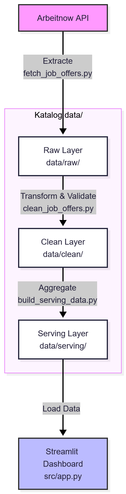
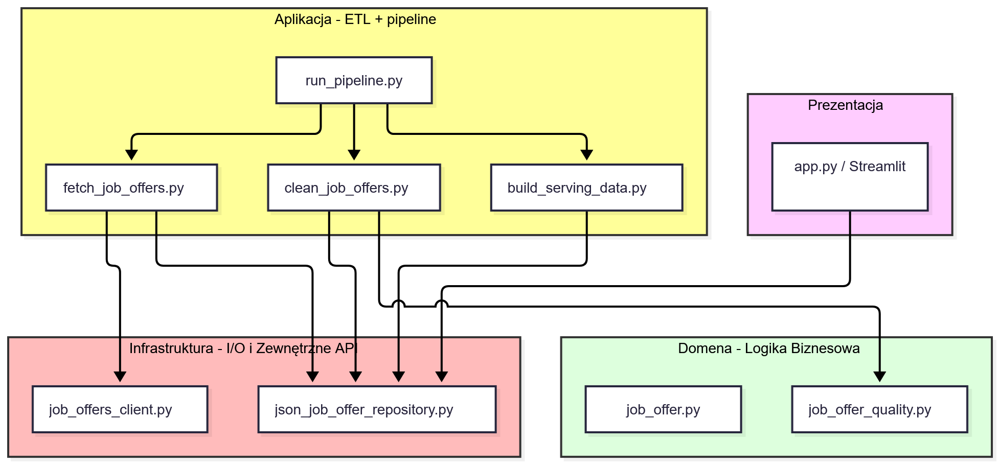

# Architektura

## Struktura plików
```
job-market-analysis/
│
├── data/                                   # Warstwy danych (Architektura Medallion)
│   ├── raw/                                # Warstwa Bronze: Surowe pliki JSON pobrane z API
│   ├── clean/                              # Warstwa Silver: Oczyszczone oferty po walidacji
│   └── serving/                            # Warstwa Gold: Zagregowane pliki JSON stworzone pod dashboard
│
├── docs/                                   # Dokumentacja projektu
│   ├── architecture.md                     # Opis architektury
│   ├── data_dictionary.md                  # Słownik danych
│   ├── decision_log.md                     # Rejestr decyzji architektonicznych i technologicznych
│   └── project_context.md                  # Kontekst biznesowy, dziedzinowy, prawny i etyczny
│
├── src/                                    # Kod źródłowy
│   ├── application/                        # ETL
│   │   ├── fetch_job_offers.py             # Pobieranie danych z API (Extract)
│   │   ├── clean_job_offers.py             # Czyszczenie tekstów, deduplikacja i walidacja (Transform)
│   │   ├── build_serving_data.py           # Agregacja danych do warstwy Gold (Load)
│   │   └── run_pipeline.py                 # Główny skrypt uruchamiający cały potok
│   │
│   ├── domain/                             # Logika biznesowa
│   │   ├── job_offer.py                    # Struktura i definicja modelu danych oferty pracy
│   │   └── job_offer_quality.py            # Reguły walidacji (sprawdzanie typów, formatów i poprawności)
│   │
│   ├── infrastructure/                     # Warstwa infrastrukturalna
│   │   ├── job_offers_client.py            # Klient HTTP obsługujący komunikację z API Arbeitnow
│   │   └── json_job_offer_repository.py    # Repozytorium odpowiedzialne za zapis i odczyt plików JSON
│   │
│   ├── app.py                              # Aplikacja analityczna (Dashboard w Streamlit)
│   └── config.py                           # Globalna konfiguracja projektu, zmienne środowiskowe i ścieżki
│
├── tests/                                  # Zautomatyzowane testy
│   └── test_job_offer_quality.py           # Testy walidujące oferty
│
├── .env.example                            # Szablon wymaganych zmiennych środowiskowych
├── requirements.txt                        # Lista zależności Pythona
├── PROGRESS.md                             # Dziennik postępów prac
└── README.md                               # Opis oraz instrukcja uruchomienia projektu
```

## Diagram potoku danych


## Diagram architektury Domain-Driven Design
